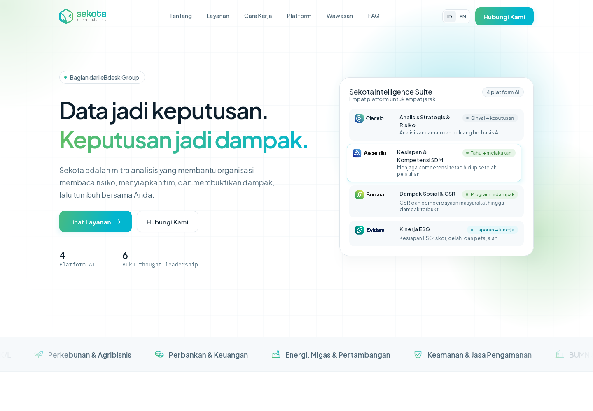

# Sekota — Company Profile (Compose Multiplatform)

Porting situs **Sekota Sinergi Indonesia** dari HTML statis ke aplikasi **Compose Multiplatform** yang berjalan di Web (Wasm/JS), Android, iOS, dan Desktop dari satu basis kode.

Sumber desain: `C:\Users\eBdesk Teknologi\Downloads\sekota-landing-page (1)\sekota-landing-page` (HTML + CSS + JS, ID/EN).



## Yang sudah dibangun

- **Landing page lengkap** — hero, marquee sektor, Tentang, 4 Layanan, Cara Kerja, 4 Platform, 6 Buku, CTA Mitra, FAQ akordeon, footer.
- **4 halaman produk** — Clarivio, Ascendio, Sociara, Evidara: masalah, 6 fitur, galeri tab dengan tur otomatis 6 detik (berhenti saat tab dipilih, nonaktif dengan reduced motion), alur 4 langkah, audiens, layanan terkait, platform lain, CTA.
- **Halaman Wawasan** — 6 buku (sampul, kutipan, paragraf, audiens, isi buku) + trilogi Sustainability Series.
- **Halaman Kontak** — formulir tervalidasi, dropdown topik, pengiriman ke `info@sekota.id` lewat API + SMTP/FormSubmit, status "Pesan terkirim" dengan nama/email pengunjung, pesan error yang menyebut email langsung, preset demo/buku/mitra. Kartu email langsung membuka aplikasi email (`mailto:info@sekota.id`) dan menyediakan tombol salin alamat.
- **Halaman Privasi & Syarat Ketentuan** — draf dari desain baru, ID/EN, daftar isi sticky dengan penomoran bagian, tautan silang dan email; terhubung dari footer dan catatan formulir kontak.
- **ID/EN** di seluruh halaman tanpa reload, termasuk deep link bahasa (`#/en`, `#/id`).
- **Responsif** — breakpoint 600/860/1100dp, menu burger, grid adaptif, diverifikasi pada 390dp, 900dp, 1440dp, dan 1920dp.
- **Navigasi hash** — URL per halaman (`#/id/product/clarivio`, `#/id/books/...`, `#/id/contact/...`), deep link, dan browser back/forward.
- **Aksesibilitas dasar** — scroll keyboard, label/status form, fokus terlihat, `lang` dokumen, dan `prefers-reduced-motion`.
- **Clean + scream architecture**, MVVM dengan StateFlow, DI Koin, design system dari token desain.
- **Test otomatis** — 77 test JVM (termasuk 8 UI Compose), 69 test Wasm, 6 test server (152 total); laporan otomatis.

## Menjalankan

```powershell
# Web (target utama)
.\gradlew.bat :app:webApp:wasmJsBrowserDevelopmentRun

# Web build produksi
.\gradlew.bat :app:webApp:wasmJsBrowserDistribution

# Desktop
.\gradlew.bat :app:desktopApp:run

# Android
.\gradlew.bat :app:androidApp:assembleDebug

# iOS: buka app/iosApp di Xcode

# Server Ktor + API kontak (port 8080)
.\gradlew.bat :server:run
```

Di Git Bash/POSIX gunakan `./gradlew` (bukan `.\gradlew.bat`).

### Mengaktifkan pengiriman email kontak

API `POST /api/contact` mengirim pesan lewat SMTP. Set variabel lingkungan berikut sebelum `:server:run`:

```powershell
$env:SEKOTA_SMTP_HOST="smtp.contoh.co.id"
$env:SEKOTA_SMTP_PORT="587"
$env:SEKOTA_SMTP_USER="no-reply@sekota.id"
$env:SEKOTA_SMTP_PASSWORD="••••"
$env:SEKOTA_MAIL_FROM="no-reply@sekota.id"
$env:SEKOTA_MAIL_TO="info@sekota.id"     # default
.\gradlew.bat :server:run
```

**Alternatif tanpa kredensial SMTP (FormSubmit):**

```powershell
$env:SEKOTA_FORMSUBMIT_TO="alamat-tujuan@contoh.com"   # penerima harus mengaktifkan form sekali
$env:SEKOTA_FORMSUBMIT_ORIGIN="https://sekota.id"      # opsional, default https://sekota.id
.\gradlew.bat :server:run
```

FormSubmit mengirim email aktivasi pada penggunaan pertama; klik tautan aktivasi sebelum pesan bisa diteruskan. Layanan ini cocok untuk uji coba, bukan produksi: email dari FormSubmit sering masuk folder Spam, dan isi pesan melewati layanan pihak ketiga. Untuk produksi gunakan SMTP resmi `sekota.id` (mis. Mailjet/SES/Google Workspace) agar SPF/DKIM lolos.

Tanpa konfigurasi SMTP/FormSubmit, endpoint mengembalikan `503` dan UI menampilkan pesan gagal + email langsung; UI tidak pernah menampilkan "terkirim" palsu. Untuk pengembangan, web statis di `:8765` memanggil API lokal di `:8090` (atau `:8080`); saat situs dilayani oleh server Ktor, API bersifat same-origin. Produksi statis murni memerlukan serverless function/API terpisah di balik `/api/contact`.

## Deployment (Docker / Podman Compose)

Satu image menjalankan Ktor yang menyajikan build Wasm dan `POST /api/contact` pada origin yang sama. Tersedia tiga environment:

```bash
# Development — http://localhost:8090, FormSubmit, tanpa TLS
cp .env.development.example .env.development
docker compose -f compose.yaml -f compose.development.yaml \
  --env-file .env.development up -d --build

# Staging — domain staging + TLS (profil proxy)
cp .env.staging.example .env.staging
docker compose -f compose.yaml -f compose.staging.yaml \
  --env-file .env.staging --profile proxy up -d --build

# Production — SMTP wajib, TLS, limit resource + log rotation
cp .env.production.example .env.production && chmod 600 .env.production
docker compose -f compose.yaml -f compose.production.yaml \
  --env-file .env.production --profile proxy up -d --build
```

Podman: ganti `docker compose` dengan `podman compose` (provider Compose diperlukan). Detail env, TLS/Caddy, rollout/rollback, dan checklist keamanan ada di [`docs/13-deployment.md`](docs/13-deployment.md).

## Test & laporan

```powershell
# Test inti + tulis docs/11-test-report.md
.\scripts\test-report.ps1

# Termasuk test Wasm (butuh Chrome/Edge)
.\scripts\test-report.ps1 -IncludeWasm

# Test + build Android/desktop/web
.\scripts\verify.ps1
```

Hasil terakhir: **152 eksekusi test, 0 gagal** → [`docs/11-test-report.md`](docs/11-test-report.md).
Verifikasi visual & aksesibilitas: [`tools/visual/`](tools/visual) (`shots.mjs`, `pages.mjs`, `a11y.mjs`) → screenshot di [`docs/screenshots/`](docs/screenshots).

## Struktur kode

```
app/shared/src/commonMain/kotlin/id/sekota
├── App.kt                 composition root (Koin, tema, router)
├── app/                   state aplikasi, navigasi, header/footer, DI
├── core/                  model, konten bersama, design system, breakpoint, aset
└── feature/
    ├── landing/           landing page + section
    ├── product/           detail produk
    ├── books/             wawasan & buku
    ├── contact/           formulir, gateway HTTP, status terkirim/gagal
    └── legal/             kebijakan privasi & syarat ketentuan
```

Setiap fitur memiliki `domain` (model + use case + interface), `data` (katalog statis + implementasi), dan `presentation` (ViewModel + Composable). Detail: [`docs/04-architecture.md`](docs/04-architecture.md).

## Dokumentasi

| Dokumen | Isi |
|---|---|
| [Analisis desain](docs/00-analisis-desain.md) | Inventaris desain, token, breakpoint, keputusan porting |
| [Requirements](docs/01-requirements.md) | FR/NFR, scope, acceptance criteria |
| [Use case diagram](docs/02-use-case-diagram.md) | Aktor & 10 use case |
| [Use case specification](docs/03-use-case-specification.md) | Alur detail tiap use case |
| [Arsitektur](docs/04-architecture.md) | Clean/scream architecture, MVVM, DI, ADR |
| [Design system](docs/05-design-system.md) | Warna, tipografi, spacing, komponen, motion |
| [Flow diagram](docs/06-flow-diagrams.md) | Navigasi, FAQ, kontak, bahasa, sprint |
| [Test strategy](docs/07-test-strategy.md) | Piramida test, matriks, quality gate |
| [Sprint plan](docs/08-sprint-plan.md) | Sprint 0–4 selesai, backlog Sprint 5 |
| [Traceability](docs/09-traceability.md) | Requirement → use case → test |
| [OpenProject sync](docs/10-openproject-sync.md) | Rencana sinkronisasi (belum dijalankan) |
| [Test report](docs/11-test-report.md) | Hasil test terbaru (otomatis) |
| [Runbook](docs/12-runbook.md) | Build, run, test, visual check, troubleshooting |

URL legal: `#/id/privacy`, `#/id/terms`, `#/en/privacy`, `#/en/terms` (alias `privasi`/`syarat-ketentuan`).

## Catatan

- Konten masih statis di katalog; belum ada CMS. Satu-satunya API adalah `POST /api/contact`.
- Formulir mengirim lewat API Ktor + SMTP; status sukses hanya tampil setelah server menerima pesan. Kredensial SMTP belum disertakan di repo.
- Endpoint kontak belum memiliki rate limit/captcha; tambahkan di depan reverse proxy sebelum tayang publik.
- Gradient brand dengan teks putih belum memenuhi WCAG AA (mengikuti desain); kontras gelap/terang lain sudah diperiksa.
- Sinkronisasi OpenProject belum dilakukan; skill PMO sudah tersedia — lihat dokumen 10.
