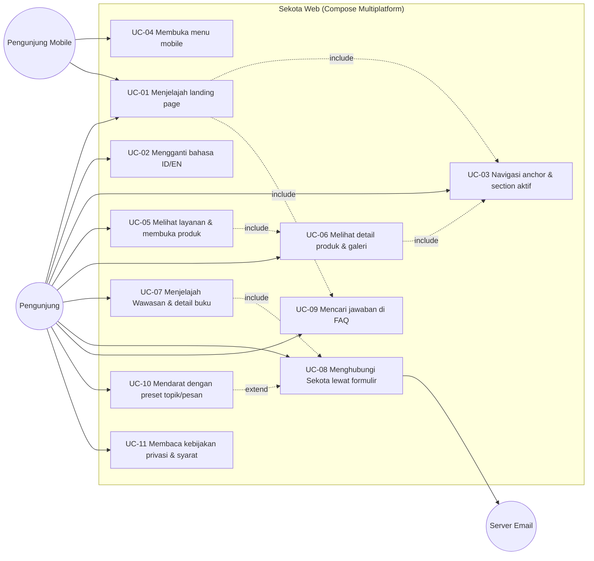

# 02 — Use Case Diagram

## Aktor

| Aktor | Deskripsi |
|---|---|
| **Pengunjung** | Pengunjung web/desktop/mobile yang mencari informasi tentang Sekota. |
| **Pengunjung Mobile** | Pengunjung pada layar <860dp yang memakai menu burger. |
| **Tim Sekota** | Pemilik konten (di luar sistem; konten saat ini diubah lewat kode/katalog, bukan UI admin). |
| **Server Email** | API Ktor + SMTP yang meneruskan pesan ke `info@sekota.id` (aktor pendukung). |

## Diagram

Catatan: Mermaid tidak memiliki notasi UML use case native; diagram di atas memakai flowchart dengan aktor dan relasi `include`/`extend` untuk maksud yang sama.

## Daftar use case

| ID | Nama | Aktor utama | Tujuan | Prioritas | Screen |
|---|---|---|---|---|---|
| UC-01 | Menjelajah landing page | Pengunjung | Memahami positioning, layanan, platform, buku | Must | Landing |
| UC-02 | Mengganti bahasa | Pengunjung | Membaca situs dalam ID atau EN | Must | Semua |
| UC-03 | Navigasi anchor | Pengunjung | Menuju section landing dengan cepat | Must | Landing + header |
| UC-04 | Membuka menu mobile | Pengunjung Mobile | Mengakses navigasi pada layar sempit | Must | Header mobile |
| UC-05 | Melihat layanan & membuka produk | Pengunjung | Memilih layanan yang relevan | Must | Landing → Product |
| UC-06 | Melihat detail produk & galeri | Pengunjung | Menilai kemampuan platform | Must | Product |
| UC-07 | Menjelajah Wawasan & buku | Pengunjung | Memahami kerangka berpikir Sekota | Must | Landing → Books |
| UC-08 | Menghubungi Sekota | Pengunjung | Mengirim pesan/demo | Must | Contact |
| UC-09 | Mencari jawaban FAQ | Pengunjung | Menjawab keberatan umum | Must | Landing |
| UC-10 | Mendarat dengan preset | Pengunjung | Formulir sudah terisi dari konteks produk/buku/mitra | Should | Product/Books → Contact |
| UC-11 | Membaca kebijakan privasi & syarat | Pengunjung | Memahami pemrosesan data dan ketentuan situs | Should | Privacy / Terms |

## Relasi requirement → use case

| Requirement | Use case |
|---|---|
| FR-01, FR-02, FR-03 | UC-01 |
| FR-04, FR-05 | UC-01, UC-03 |
| FR-06 | UC-04 |
| FR-07, FR-21 | UC-02 |
| FR-08, FR-09, FR-10 | UC-05, UC-06 |
| FR-11, FR-12, FR-13 | UC-07 |
| FR-14, FR-15, FR-16, FR-19 | UC-08 |
| FR-17 | UC-10 |
| FR-18 | UC-09 |
| FR-22 | UC-03, UC-05, UC-07 |
| FR-26 | UC-11 |
