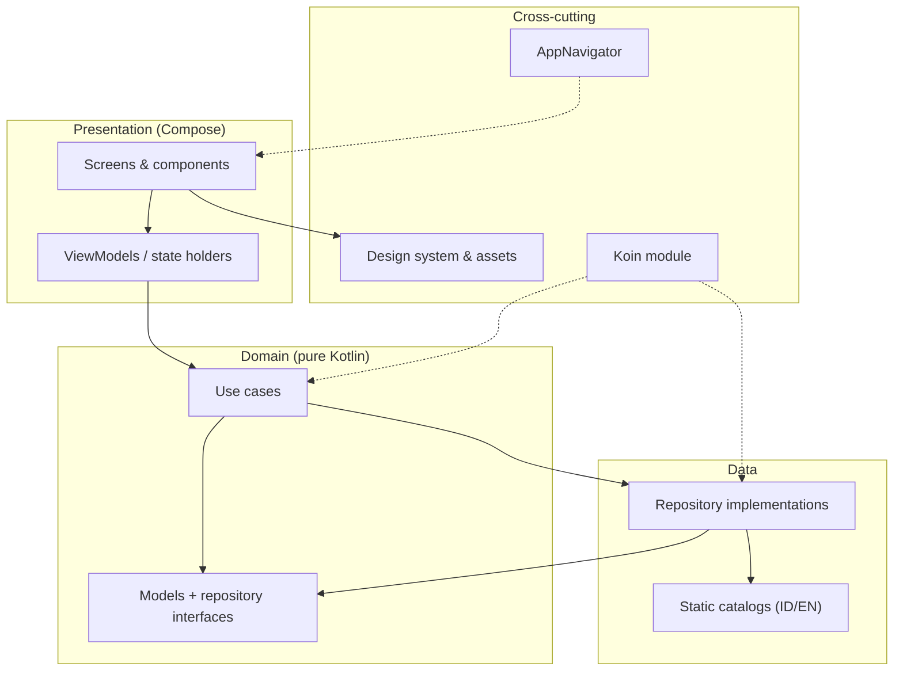
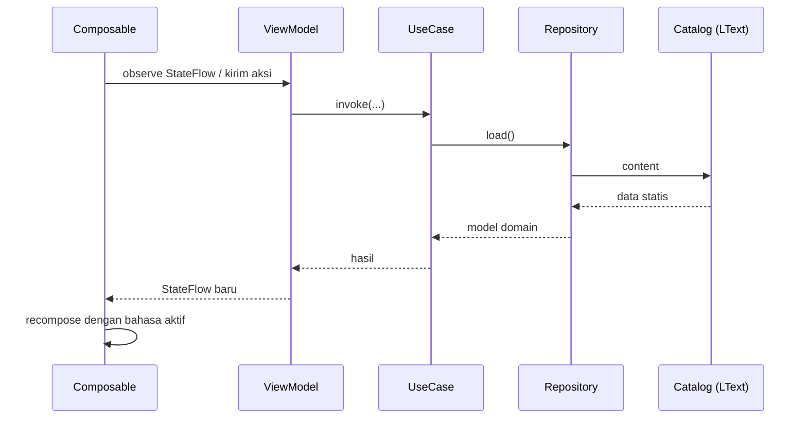
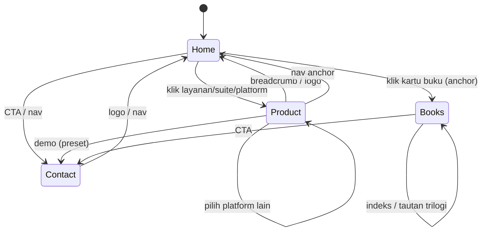

# 04 — Arsitektur

## 1. Prinsip

1. **Clean architecture** — aturan dependensi: `presentation → domain ← data`. Domain tidak mengetahui Compose, Koin, resource, atau platform. Data mengimplementasikan interface domain. Presentation hanya berbicara dengan use case.
2. **Scream architecture** — struktur paket berbicara tentang kemampuan produk, bukan tentang tipe file: `feature/landing`, `feature/product`, `feature/books`, `feature/contact`, `feature/legal`. Di dalamnya baru ada `domain`, `data`, `presentation`.
3. **Web-first, multiplatform-ready** — seluruh UI di `commonMain`; target Android/iOS/Desktop/JS/Wasm memakai `App()` yang sama.
4. **Content as data** — semua copy & aset berasal dari katalog `LText`; tidak ada string bisnis yang tersebar di composable.
5. **Test di lapisan yang tepat** — logika di domain dan view model murni; UI diuji dengan Compose UI test; visual diverifikasi dengan screenshot.

## 2. Peta modul Gradle

```
:app:shared  (Android/iOS/JVM/JS/Wasm, Compose UI + fitur)
   ├── api(:core)                 ← logika lintas target (saat ini GreetingUtil)
   ├── :app:androidApp            ← entry point Android
   ├── :app:desktopApp            ← entry point Desktop
   ├── :app:webApp                ← entry point web (JS + Wasm)
   └── app/iosApp                 ← shell SwiftUI + framework Shared
:server  (Ktor)                    ← api(:core), tidak memakai UI
```

> **Keputusan:** fitur tetap di dalam satu modul `:app:shared` dengan **paket feature-first**, bukan enam modul Gradle terpisah. Alasannya: (a) target web lebih dulu dan build KMP+AGP 9 per modul menambah waktu/risiko, (b) batas domain sudah ditegakkan lewat paket dan arah dependensi, (c) pemecahan menjadi `:feature:*` bisa dilakukan tanpa mengubah kode domain/presentation karena tidak ada akses lintas fitur selain lewat `core`. Lihat ADR-001.

## 3. Struktur paket (`app/shared/src/commonMain/kotlin/id/sekota`)

```
App.kt                         composition root: Koin + Theme + WindowSize + router switch
app/
  AppState.kt                  bahasa, status header, router
  navigation/Route.kt          Home / Product / Books(anchor) / Contact(preset) / Privacy / Terms
  navigation/AppNavigator.kt   stack, back, pending anchor
  chrome/SiteHeader.kt         nav fixed, toggle bahasa, menu mobile
  chrome/SiteFooter.kt         footer lintas halaman
  di/AppModule.kt              binding Koin
core/
  model/                       Language, LText, ProductSlug, BookSlug, IconKey
  content/SiteContent.kt       copy bersama (nav, footer, nama produk)
  designsystem/                warna, tipografi, komponen, ikon, surface
  ui/                          WindowSize/breakpoints, aset, mapping ikon
feature/
  landing/
    domain/   LandingModels, GetLandingContent, LandingRepository
    data/     LandingCatalog, StaticLandingRepository
    presentation/ LandingViewModel, LandingScreen, section/*
  product/
    domain/   ProductDetail, GetProductDetail, ProductRepository
    data/     ProductCatalog, StaticProductRepository
    presentation/ ProductViewModel, ProductDetailScreen
  books/
    domain/   BooksPageContent, GetBooks, BooksRepository
    data/     BooksCatalog, StaticBooksRepository
    presentation/ BooksScreen
  contact/
    domain/   ContactForm, validator, SubmitContactMessage, ContactGateway
    data/     ContactCatalog, prefill, HttpContactGateway
    presentation/ ContactViewModel, ContactScreen
  legal/
    domain/   LegalDoc, sections/blocks, GetLegalDoc, LegalRepository
    data/     LegalCatalog (ID/EN), StaticLegalRepository
    presentation/ LegalScreen (hero, TOC, numbered sections)
```

## 4. Diagram lapisan



## 5. Alur data



## 6. Dependency injection (Koin 4.1.1)

`app/di/AppModule.kt`:

| Binding | Implementasi | Konsumen |
|---|---|---|
| `LandingRepository` | `StaticLandingRepository` | `GetLandingContent` |
| `GetLandingContent` | — | `LandingViewModel` |
| `ProductRepository` | `StaticProductRepository` | `GetProductDetail` |
| `GetProductDetail` | — | `ProductDetailScreen` |
| `BooksRepository` | `StaticBooksRepository` | `GetBooks` |
| `GetBooks` | — | `BooksScreen` |
| `ContactRepository` | `StaticContactRepository` | `GetContactContent` |
| `GetContactContent` | — | `ContactScreen` (copy + preset) |
| `SubmitContactMessage` | — | `ContactViewModel` |

- Koin dimulai dengan `KoinApplication { modules(appModule) }` di `App()`.
- View model dibuat dengan `remember { ... }` di layar (bukan `koinViewModel`) agar tidak bergantung pada `ViewModelStoreOwner` platform; dependensi tetap berasal dari Koin (`koinInject`).
- Untuk test UI, `KoinApplication` yang sama dipakai; repository dapat diganti dengan fake karena binding berbasis interface.

**Mengganti ke API/CMS:** buat `RemoteLandingRepository : LandingRepository`, ubah satu baris binding; presentation tidak berubah.

## 7. MVVM vs MVI

Yang dipakai: **MVVM dengan intent-style methods**.

| Layar | State holder | Alasan |
|---|---|---|
| Landing | `LandingViewModel` (`StateFlow<LandingUiState>`) | Interaksi terbatas: highlight rotasi + akordeon FAQ. |
| Product | `ProductViewModel` | Hanya pemilihan tab galeri. |
| Contact | `ContactViewModel` | Form + validasi + status submit adalah alur state paling kompleks. |
| Books | Tanpa VM | Konten statis; satu-satunya state adalah scroll/anchor yang dikelola UI. |
| Shell | `AppState` | Bahasa, status header, dan router bersifat aplikasi, bukan milik satu fitur. |

MVI penuh (satu `Intent` sealed untuk semua aksi) tidak dipilih karena menambah boilerplate tanpa manfaat pada alur sederhana ini. Bila nanti ada pencarian/filter konten atau alur multi-langkah, `ContactViewModel` dapat dinaikkan ke MVI dengan menambahkan `sealed interface ContactIntent`.

## 8. Navigasi



- `AppNavigator` menyimpan stack, `pendingHomeAnchor` (one-shot scroll) dan `homeAnchor` (bagian URL).
- **Hash routing** aktif di web: `#/id`, `#/en`, `#/id/home/layanan`, `#/id/product/clarivio`, `#/id/books/{anchor}`, `#/id/contact/{preset}`, `#/id/privacy`, `#/id/terms` (alias `privasi`/`syarat-ketentuan`). Deep link, refresh, dan browser back/forward bekerja; perubahan hash eksternal diterapkan tanpa menulis ulang history.
- Hash ditulis oleh `HashRouting` (expect/actual): web memakai `window.location.hash` dan atribut `data-route` untuk verifikasi; target lain no-op.
- Anchor landing dipetakan ke indeks `LazyColumn` (`sectionKeys`) dengan offset header 80dp; halaman buku ke `BookSlug.anchor`.
- Keyboard scroll (PageUp/PageDown/Home/End/Arrow) ditangani di root `App` memakai `AppState.activeListState`.

## 9. Internasionalisasi

- `Language { ID, EN }` dan `LText(id, en)` di `core/model`.
- Semua katalog mengisi kedua bahasa; UI memanggil `text[language]`.
- `AppState.language` adalah satu-satunya sumber; toggle di header.
- Tidak ada resource string Android/iOS; pendekatan ini menjaga konten identik di semua target dan mudah diuji.

## 10. Aset, font, dan design system

- Font TTF dibundel dan dimuat via `org.jetbrains.compose.resources.Font` di `sekotaType()`.
- Gambar di `composeResources/drawable` dengan nama `snake_case`; `core/ui/Assets.kt` memetakan `ProductSlug`/`BookSlug` ke `DrawableResource`.
- `SekotaTheme` menyediakan `LocalSekotaType` dan `LocalSekotaPalette`; komponen tidak memakai warna hardcoded di layar.
- Ikon adalah `ImageVector` dari path SVG desain (`SekotaIcons`), tanpa dependensi ikon eksternal.

## 11. Aksesibilitas & motion

- `prefers-reduced-motion` dibaca lewat `prefersReducedMotion()`; marquee, highlight otomatis, count-up, dan reveal dinonaktifkan/dipangkas.
- Form memakai semantics label + error; burger/menu/language/FAQ memiliki role dan state; `lang` dokumen mengikuti bahasa.
- Fokus keyboard terlihat pada tombol, kartu, dan nav; target sentuh utama minimal 44dp.

## 12. Web-first

- Entry point `app/webApp/src/webMain/kotlin/id/sekota/main.kt` memakai `ComposeViewport { App() }`.
- Bundle produksi: app wasm ±3,45 MiB, skiko wasm ±8,25 MiB, JS ±521 KiB. Belum ada code splitting; dicatat sebagai risiko NFR-02.
- Kontak memakai Ktor Client (`HttpContactGateway`) untuk `POST /api/contact`; `:server` memvalidasi ulang lalu mengirim lewat Jakarta Mail/SMTP. Web statis di localhost memakai API `:8090` (atau `:8080`); saat dilayani server Ktor, API same-origin.
- Status "terkirim" hanya dipasang setelah respons 2xx; kegagalan/503 menampilkan error + email langsung, tanpa fallback `mailto:` palsu.

## 13. Keputusan arsitektur (ADR)

| ADR | Keputusan | Alasan | Konsekuensi |
|---|---|---|---|
| ADR-001 | Satu modul `:app:shared`, paket feature-first | Kecepatan build web-first, batas domain tetap jelas | Pemecahan modul nanti tanpa ubah domain |
| ADR-002 | MVVM + StateFlow, bukan MVI penuh | Kompleksitas UI rendah–sedang | Intent terasa seperti method; mudah dites |
| ADR-003 | Koin sebagai DI | Multiplatform, ringan, sudah tersedia di cache | Menambah satu dependensi runtime |
| ADR-004 | Konten statis di katalog, bukan API | Situs sumber statis; offline; test deterministik | Perubahan konten butuh rilis |
| ADR-005 | Kontak via API Ktor + SMTP | Desain menyerahkan `sendMessage` ke developer; status sukses harus nyata | Butuh kredensial SMTP dan endpoint produksi; endpoint perlu rate limit |
| ADR-006 | Ikon sebagai path `ImageVector` | Persis desain, tanpa paket ikon besar | Perlu menambah path manual untuk ikon baru |
| ADR-007 | Router internal + hash routing di web | Deep link, refresh, browser back; tetap tanpa library navigasi | Format URL harus dijaga `HashRouteTest`; Android hardware back belum terhubung |
| ADR-008 | `LText` di kode, bukan resource platform | Konsistensi semua target + mudah diuji | Tidak bisa diterjemahkan tanpa rilis |

## 14. Risiko teknis

| Risiko | Dampak | Mitigasi |
|---|---|---|
| Bundle Wasm besar (skiko 8,25 MiB) | Waktu muat awal | Code splitting, kompresi Brotli di hosting, ukur LCP |
| SEO terbatas (canvas) | Tidak terindeks penuh | Metadata dasar ada; SSR/static prerender Sprint 5 |
| `LocalClipboardManager` deprecated | Peringatan build | Migrasi ke `LocalClipboard` |
| Android hardware back belum terhubung | Back keluar aplikasi | Tambah BackHandler/expect back di Sprint 5 |
| Animasi `Reveal` tidak menghormati reduced-motion | Aksesibilitas | Tambah `LocalMotionEnabled` per platform |
| Kebocoran state antar rute | Form terisi saat kembali | `remember(initialPreset)` membuat VM baru; tambah reset eksplisit bila perlu |
