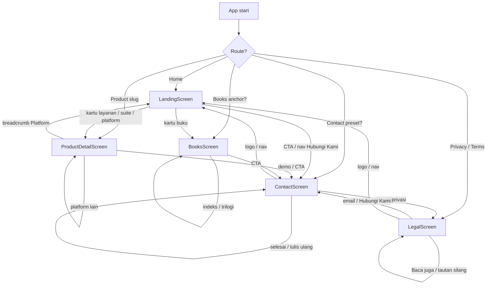
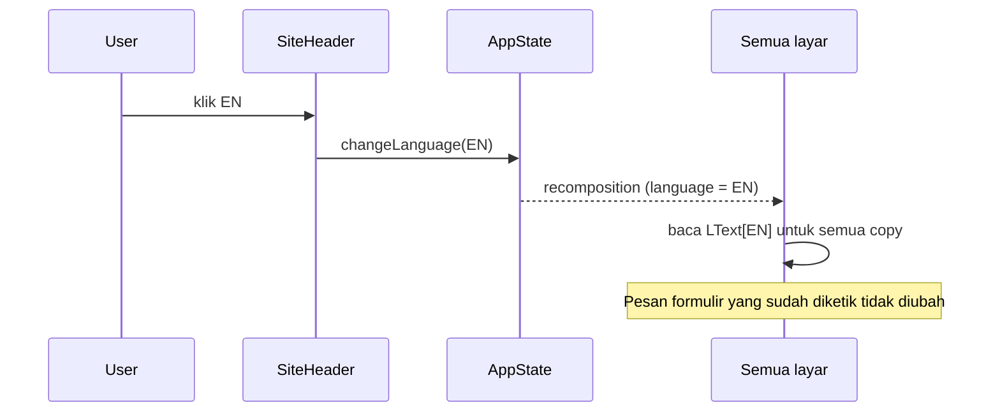
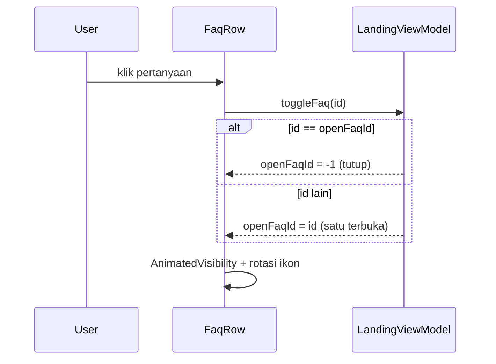
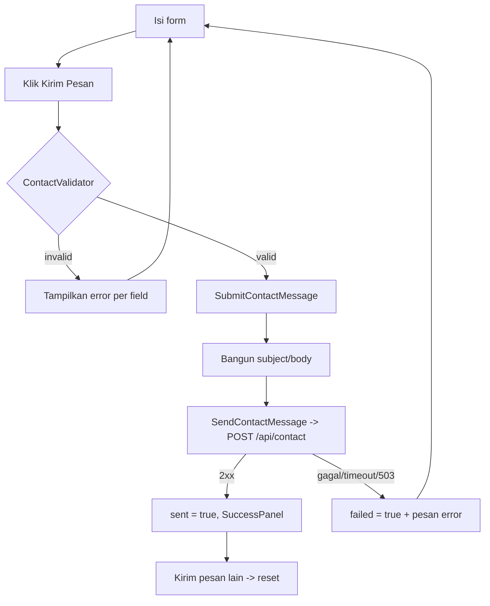
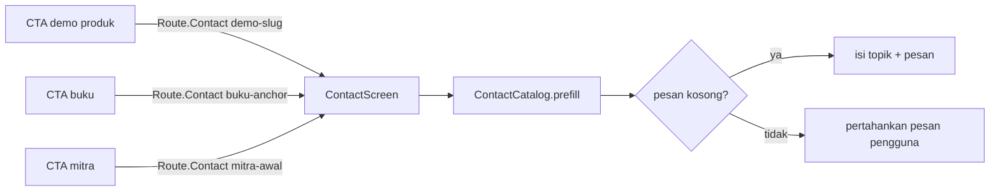
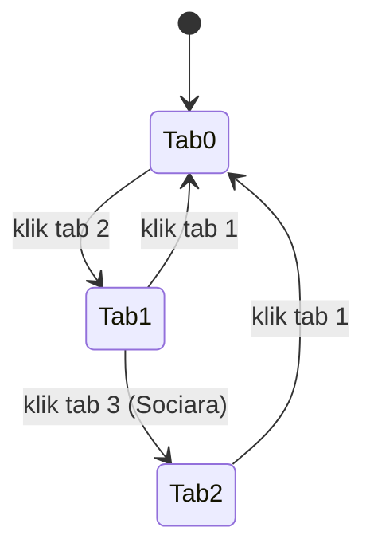
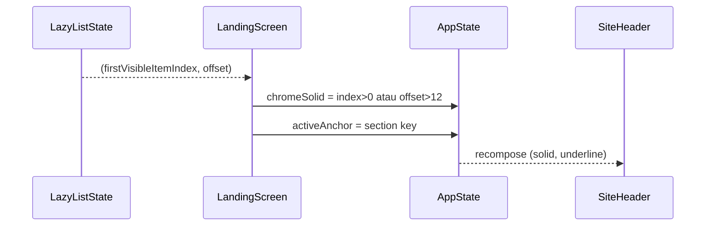
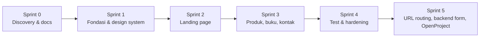
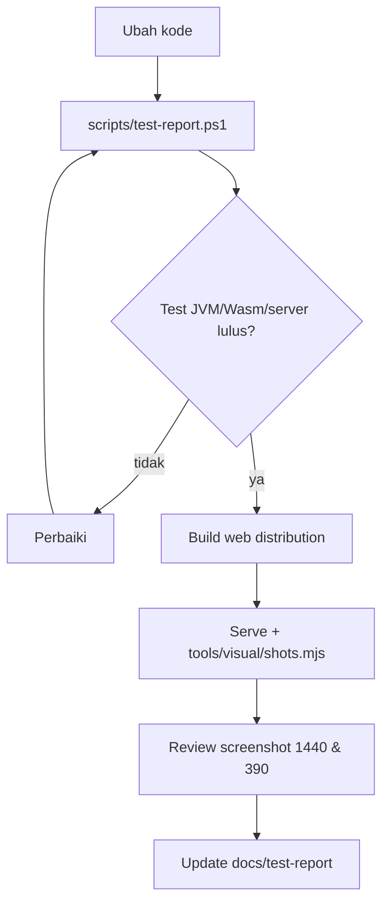

# 06 — Flow Diagram

## 1. Navigasi aplikasi



## 2. Language switch



## 3. FAQ accordion



## 4. Formulir kontak



Label subjek: `[Website] {topik} – {nama}`. Body:

```
Nama: ...
Email: ...
Topik: ...

{pesan}
```

Server memvalidasi ulang nama/email, lalu `SmtpMailer` mengirim ke `SEKOTA_MAIL_TO` (default `info@sekota.id`) dengan `Reply-To` pengunjung. UI tidak pernah menampilkan sukses untuk kegagalan.

## 5. Preset deep-link



## 6. Galeri produk



State disimpan di `ProductViewModel.selectedScreen`; indeks di luar rentang diabaikan.

## 7. Scroll & chrome



## 8. Alur sprint



## 9. Verifikasi lokal


